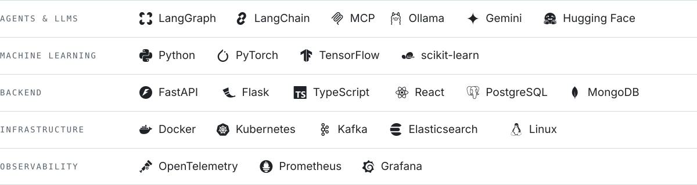

<picture>
  <source media="(prefers-color-scheme: dark)" srcset="https://raw.githubusercontent.com/geekyuvi069/geekyuvi069/main/assets/header-dark.svg">
  
</picture>

  
  <a href="https://my-portfolio-yuvi.vercel.app"><b>Portfolio</b></a> &nbsp;/&nbsp;
  <a href="https://linkedin.com/in/yuvraj-kumar-711393264"><b>LinkedIn</b></a> &nbsp;/&nbsp;
  <a href="mailto:geekyuvi069@gmail.com"><b>Email</b></a> &nbsp;/&nbsp;
  <a href="https://drive.google.com/file/d/1tZz5K0yBircwrr6RDgOqa1Mn4eJ6ytje/view?usp=sharing"><b>Resume ↗</b></a>

### About

I build LLM systems that do real work and can show the evidence behind every answer. I'm an R&D intern at **Fortinet**, building a multi-agent platform that investigates Kubernetes incidents over live telemetry; it cut time-to-root-cause from about ten minutes to under three.

B.E. Information Science, MVJ College of Engineering, 2026. **Open to full-time AI/ML engineering roles.**

### Experience

**Fortinet** &nbsp;R&D Intern &nbsp;MAR 2026 – PRESENT · BENGALURU  
A LangGraph orchestrator and five domain agents gather live evidence over MCP, every claim is grounded against a ChromaDB knowledge base, and the whole graph is traced with OpenTelemetry. Fully self-hosted on Ollama.

**AI4SEE** &nbsp;Data Science Intern &nbsp;JAN – MAR 2026 · REMOTE  
End-to-end ML models, from experiment notebooks to reproducible, deployable training pipelines.

**InternPe** &nbsp;AI/ML Intern &nbsp;JUL – AUG 2025 · REMOTE  
FAISS semantic search over 500+ QA test cases that flags near-duplicates, cutting manual review by about 70%.

### Selected work

<samp>01</samp> &nbsp;**[MediAssist](https://github.com/geekyuvi069/CureLink)** &nbsp;FASTAPI · REACT · POSTGRESQL · GEMINI  
An agentic appointment assistant: the LLM chooses tools to find doctors, book free slots, create Google Calendar events and alert doctors on Slack.

<samp>02</samp> &nbsp;**[LLM Response Evaluator](https://github.com/geekyuvi069/LLM-Evaluator)** &nbsp;PYTHON · FLASK · [LIVE ↗](https://llm-evaluator-ten.vercel.app)  
Scores a chatbot's answer against its retrieved context for relevance, completeness and hallucination risk, plus latency and token cost.

<samp>03</samp> &nbsp;**[SpecTacular.AI](https://github.com/geekyuvi069/SmartSpec-AI-SpecTacular.AI-)** &nbsp;FAISS · TRANSFORMERS · FLASK  
Turns requirement documents into traceable test cases, fully offline; clustering removed 85% of duplicate cases.

<samp>04</samp> &nbsp;**[Anchor](https://github.com/geekyuvi069/Anchor)** &nbsp;PYTHON · OLLAMA · CLI  
A local AI pair programmer for the terminal. Code never leaves the machine, every diff is validated before it lands, and undo is one command.

<samp>05</samp> &nbsp;**[PingMe](https://github.com/geekyuvi069/PingMe)** &nbsp;PYTHON · GEMINI  
A productivity tracker that auto-categorises your day, sends mid-day nudges and weekly insights, and keeps a reading habit on track.

<samp>06</samp> &nbsp;**[GB Wind Forecast Monitor](https://github.com/geekyuvi069/wf7kq)** &nbsp;PYTHON · ELEXON DATA · [LIVE ↗](https://wf7kq.vercel.app)  
Compares the wind forecast available at decision time with actual generation and turns the error into a day-ahead buying margin.

### Stack

<picture>
  <source media="(prefers-color-scheme: dark)" srcset="https://raw.githubusercontent.com/geekyuvi069/geekyuvi069/main/assets/stack-dark.svg">
  
</picture>

### Activity

<picture>
  <source media="(prefers-color-scheme: dark)" srcset="https://raw.githubusercontent.com/geekyuvi069/geekyuvi069/output/snake-dark.svg">
  
</picture>
