  

  <picture>
    <source media="(prefers-color-scheme: dark)" srcset="https://readme-typing-svg.demolab.com?font=Fira+Code&weight=500&size=20&pause=1200&color=A78BFA&center=true&vCenter=true&width=720&lines=Building+multi-agent+LLM+systems+with+LangGraph+%2B+MCP;R%26D+Intern+%40+Fortinet%3A+Kubernetes+root-cause+agents;RAG+%C2%B7+grounding+%C2%B7+evals+%C2%B7+LLM+observability;Open+to+full-time+AI%2FML+Engineer+roles">
    
  </picture>

  
  
  
  
  

> [!NOTE]
> **Open to full-time AI/ML Engineer roles** (2026 graduate, Bengaluru). I build agentic LLM systems end to end, from orchestration and retrieval to evals and tracing. [Resume](https://drive.google.com/file/d/1tZz5K0yBircwrr6RDgOqa1Mn4eJ6ytje/view?usp=sharing) · [geekyuvi069@gmail.com](mailto:geekyuvi069@gmail.com)

# 💻 Tech Stack:
                  

## 👋 About me

I build LLM systems that do real work and can show the evidence behind every answer. At **Fortinet R&D** I'm building a multi-agent platform that investigates Kubernetes incidents over live telemetry; it cut NOC time-to-root-cause from about 10 minutes to under 3.

- 🧠 **Focus:** agent orchestration (LangGraph, MCP), RAG, grounding and evals, LLM observability
- 🎓 **Education:** B.E. Information Science, MVJ College of Engineering, Bengaluru (2022–2026, CGPA 8.5)
- 💬 **Ask me about:** multi-agent design, self-hosted LLMs with Ollama, tracing agents with OpenTelemetry

## 💼 Experience

**R&D Intern · Fortinet** · *Mar 2026 – present · Bengaluru*  
Multi-agent root-cause analysis for Kubernetes. A LangGraph orchestrator routes each incident to five domain agents (Kubernetes, Prometheus, Elasticsearch, Kafka, FortiMonitor) that pull live evidence through MCP tools and return ranked verdicts. Every claim is checked against a ChromaDB knowledge base before it reaches an engineer, the agent graph is traced with OpenTelemetry in Arize Phoenix, and all inference runs on self-hosted Ollama models.

**Data Science Intern · AI4SEE** · *Jan – Mar 2026 · Remote*  
Built and evaluated ML models end to end, and turned experiment notebooks into reproducible, deployable training scripts.

**AI/ML Intern · InternPe** · *Jul – Aug 2025 · Remote*  
FAISS semantic search and clustering over 500+ QA test cases that flags near-duplicates automatically, cutting manual review by about 70%.

## 📌 Projects  
- **[SpecTacular.AI](#)** – Smart Test Case Generator (Flask + FAISS + Tailwind)  
- **Real-Time Object Detection for Visually Impaired** – YOLO-based wearable assistive system  
- **Fake News Detection** – SVM & LSTM pipeline for misinformation filtering  
- **Sentiment Analysis** – NLP + LSTM-based text classification  
- **Image Compressor (ML & DL)** – Autoencoders + PCA for high-quality compression  

---

## 🎓 Certifications  
- Data Analyst Certification  
- Deloitte Australia – Data Analytics Job Simulation  
- Tata – GenAI Powered Data Analytics Job Simulation  
- AWS Educate – Introduction to Cloud 101  

# 📊 GitHub Stats:
 
 

## 🏆 GitHub Trophies

---

<!-- Proudly created with GPRM ( https://gprm.itsvg.in ) -->
