

  

  
  
  
  

  




  <a href="https://github.com/geekyuvi069/CureLink"></a>
  <a href="https://github.com/geekyuvi069/LLM-Evaluator"></a>

  <a href="https://github.com/geekyuvi069/SmartSpec-AI-SpecTacular.AI-"></a>
  <a href="https://github.com/geekyuvi069/Anchor"></a>

  <a href="https://github.com/geekyuvi069/PingMe"></a>
  <a href="https://github.com/geekyuvi069/wf7kq"></a>


<picture>
  <source media="(prefers-color-scheme: dark)" srcset="https://raw.githubusercontent.com/geekyuvi069/geekyuvi069/output/snake-dark.svg">
  
</picture>
